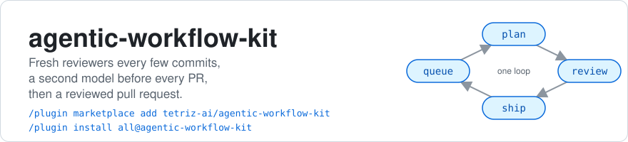
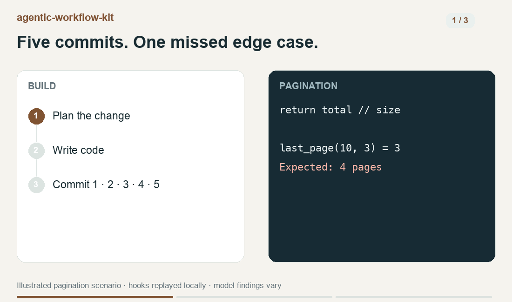
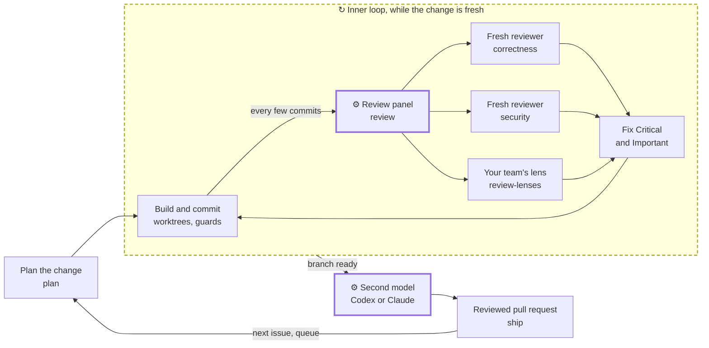

<picture>
  <source media="(prefers-color-scheme: dark)" srcset=".github/assets/banner-dark.svg">
  
</picture>

[](LICENSE)


Coding agents write code faster than anyone reviews it, and review usually starts only once the
pull request is open and the change has gone cold. This kit brings fresh, independent reviewers
into the agent's loop every few commits, adds a second model before the pull request, and carries
the change to a reviewed pull request.



Catch a missed edge case, fix it, and carry the change through review. [Demo details](.github/assets/demo/README.md).

## How it works

<details>
<summary>Implementation flow</summary>



A hook counts commits and changed lines, so no one has to remember to ask. Every few commits it
has the agent bring in the panel: one fresh subagent per lens, findings graded Critical, Important
or Minor. Before the pull request, Codex reviews Claude's work and Claude reviews Codex's, when
that CLI is on your PATH.


</details>

## Quick start

Needs macOS or Linux, git, jq, bash 3.2+ and Claude Code 2.1.289+. The GitHub skills also need a
logged-in `gh`.

1. In Claude Code, add the marketplace.

   ```text
   /plugin marketplace add tetriz-ai/agentic-workflow-kit
   ```

2. Install every plugin. For the scope, pick "Install for all collaborators on this repository",
   so hooks act only here.

   ```text
   /plugin install all@agentic-workflow-kit
   ```

   Some skills can push or open pull requests unasked, as
   [the side-effects list](docs/reference.md#skills-with-side-effects) shows.

3. Set up your repo. When asked, set `commit_gate` to your test command, such as `make test`.

   ```text
   /starter:setup
   ```

   It shows what it would write and waits for your answer. Commit the files it writes.

Now work as usual. Say the agent writes a pagination helper over five commits. The last commit
computes the last page with an off-by-one that no test asks about, so your tests pass. On the
fifth commit, the review hook adds this to the agent's context:

```text
[review-cadence] 5 commit(s) / 6 changed line(s) since the last reviewer-panel run (threshold: 5 commits or 200 lines). Before continuing, run the soft reviewer panel: invoke the `review-panel` skill (cadence mode) - it picks the lenses that fit the diff and grades findings Critical/Important/Minor. Fix Critical/Important, then continue. SOFT means findings never block this commit or the merge gate - not that the run is optional. The panel resets this cadence when it runs.
```

The agent then runs the panel. In one recorded run on this scenario's code, with its hint comment
removed, the panel caught the off-by-one. Findings vary by model and run. Its first finding, as recorded:

```text
Important  paginate.py:6  (correctness, runtime-attack, simplification)
`last_page` rounds down with `//`, so the partial last page is lost: `last_page(10,3)=3` (should be 4) and `last_page(2,5)=0` (should be 1).
Fix: Use ceiling division, `-(-total // size)`. Test total = 0, 1, size-1, size, size+1.
```

<details>
<summary>All six findings from that run</summary>

```text
| Severity | Regression | File:line | Lens | Finding | Fix |
|---|---|---|---|---|---|
| Important | | paginate.py:6 | correctness, runtime-attack, simplification | `last_page` rounds down with `//`, so the partial last page is lost: `last_page(10,3)=3` (should be 4) and `last_page(2,5)=0` (should be 1). | Use ceiling division, `-(-total // size)`. Test total = 0, 1, size-1, size, size+1. |
| Important | | paginate.py:5-6 | correctness, runtime-attack, security | No input checks: `size=0` raises ZeroDivisionError, which becomes a 500 if size comes from a request. Negative or float inputs return nonsense, e.g. `last_page(10,-3)=-4`, `last_page(10,2.5)=4.0`. | At the start, raise ValueError unless `total >= 0` and `size >= 1`, both ints. Callers return 400 on it. Add tests. |
| Important | | paginate.py:1-4 | simplification, correctness, runtime-attack | `page_1`–`page_4` are dead `pass` stubs with no callers. A function per page cannot handle page 5 or later. | Delete them. Add one `page(items, number, size)` function when it is needed. |
| Minor | | paginate.py:5 | correctness | Nothing says whether the return value is a 0-based index or a 1-based page count, and the current code is wrong under both. | Add a docstring stating the convention and a test that checks it. |
| Minor | | paginate.py:5 | runtime-attack | No cap on `size`, so a later LIMIT or slice could pull the whole dataset in one request. | Add `MAX_PAGE_SIZE` and clamp or reject `size` in the same check. |
| Minor | | paginate.py | runtime-attack | The change adds no tests. | Add `test_paginate.py` with the boundary cases above. |
```

</details>

Codex, single plugins and setup from a shell are
in [docs/install.md](docs/install.md).

## What's in the box

| Plugin | Use it for |
|---|---|
| [review](docs/plugins.md#review) | a graded review of the diff so far, from one fresh reviewer per focus, such as correctness or security |
| [review-lenses](docs/plugins.md#review-lenses) | extra reviewers for paths with team rules, such as migrations or performance |
| [ship](docs/plugins.md#ship) | opening a linked pull request and answering its review |
| [queue](docs/plugins.md#queue) | shipping labelled issues, one pull request each |
| [plan](docs/plugins.md#plan) | design docs, task slices and decision records before the code |
| [worktrees](docs/plugins.md#worktrees) | parallel agents, each in a worktree with your local files |
| [guards](docs/plugins.md#guards) | blocking failing commits, stale lockfiles and unpinned `npx`, and formatting each edited file |
| [learn](docs/plugins.md#learn) | a profile of how you work, shared as a pull request |
| [starter](docs/plugins.md#starter) | the repo files and settings the other plugins read |
| [all](docs/plugins.md#all) | every plugin above in one install |

[docs/usage.md](docs/usage.md) walks the loop skill by skill.

### What it does not do

- It does not merge into your base branch on its own.
- It works with GitHub only.
- It does not replace your CI or branch protection.

## Common tasks

### Review the work so far

By default, a hook asks the agent to run the review panel every five commits or 200 changed
lines. Run it yourself any time, or with `pre-pr` over the whole branch before a pull request:

```text
/review:review-panel
/review:review-panel pre-pr
```

The panel grades each finding Critical, Important or Minor. With `pre-pr`, it also sends the
branch's commits to Codex when the `codex` CLI is on your PATH. When Codex wrote the change, it
sends them to Claude instead. Findings are model judgments, so there is no fixed output to show.

### Block a commit while a test fails

With `commit_gate` set, the guards block an agent's commit when your test command fails. This
tries them from a shell, with no Claude Code. It sends each guard script the input Claude Code
would send, in a scratch repo whose `commit_gate` runs a failing test.

```sh
git clone https://github.com/tetriz-ai/agentic-workflow-kit && cd agentic-workflow-kit
kit="$PWD"
( cd "$(mktemp -d)" && export HOME="$PWD"   # a scratch HOME, so your settings stay untouched
  bash "$kit/examples/guarded-commits/setup.sh" "$PWD" && cd repo
  agent() { printf '{"tool_input":{"command":"%s"}}' "$2" | bash "$kit/plugins/guards/scripts/$1"; echo "(hook exit $?)"; }
  cat .agentic-workflow-kit.json
  agent commit-gate.sh 'git commit -m paginate'
  agent block-unpinned-npx.sh 'npx -y create-widget'
  agent block-unpinned-npx.sh 'npx -y create-widget@2.4.1' )
```

```text
{"commit_gate": "./test.sh"}
Commit gate failed — commit blocked.
  command: ./test.sh

1 test failed: last_page(10, 3) == 3, want 4

Fix the failure above, then commit again.
(hook exit 2)
Blocked by policy: 'create-widget' is not pinned to an exact version.
Use: npx -y create-widget@<x.y.z> (check npm view create-widget version)
(hook exit 2)
(hook exit 0)
```

The pinned `npx` command is allowed, so its hook exits 0. The snippet runs only the guard, not
`npx`.

### Replay every scenario offline

From a clone, this replays each scenario under [examples/](examples/README.md) with no model.

```sh
scripts/run-examples.sh
```

```text
ok   domain-lenses: passed=6 failed=0
ok   edit-time-checks: passed=12 failed=0
ok   guarded-commits: passed=8 failed=0
ok   mid-feature-review: passed=5 failed=0
ok   stale-pr-description: passed=5 failed=0
ok   usage-paced-queue: passed=9 failed=0
ok   worktrees-in-parallel: passed=6 failed=0
7 example(s), 0 failed
```

## Limitations

- The guard hooks catch ordinary commands, not disguised ones. Keep CI and branch protection.
- `learn` blocks a push that carries a credential, but not names. Read the profile before you confirm the push.
- The lockfile gate allows a commit when its package manager is missing. Install it.
- Review findings are model judgments. Keep your tests and merge gate as the blocking checks.
- The Codex and Claude cross-model lenses see committed work only. Commit before a pre-PR review.

[docs/limitations.md](docs/limitations.md) lists every limit and the test that pins it.

## More

- [Plugins](docs/plugins.md): each plugin's skills, hooks and usage
- [Usage](docs/usage.md): the loop from a design to a reviewed pull request
- [Install](docs/install.md): Codex, single plugins, setup from a shell, the Codex bridge
- [Reference](docs/reference.md): side effects, what each part needs, compatibility
- [Settings](docs/settings.md): every setting and its default
- [Examples](examples/README.md): the scenarios, replayed without a model
- [Changelog](CHANGELOG.md), [Contributing](CONTRIBUTING.md), [Security](SECURITY.md)
- [License](LICENSE): MIT. [NOTICE](NOTICE) lists the third-party material.

The kit follows semantic versioning. Before v1.0, skill names, settings and hook messages may
change, and the changelog lists every change.

Copyright 2026 Workloom Solutions Private Limited. The project's team is listed in
[CONTRIBUTORS.md](CONTRIBUTORS.md).
