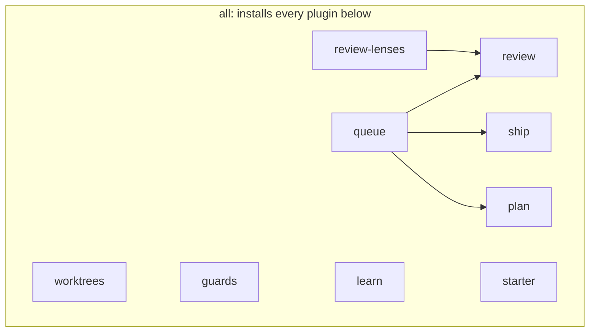

# Install

The recommended route is Claude Code with every plugin installed, as the README's Quick start
shows. This page adds the detail behind each step and the other routes.

## Requirements

You supply macOS or Linux, git, jq, bash 3.2 or later and Claude Code 2.1.289 or later. The
skills that talk to GitHub also need a GitHub repository and a logged-in `gh`.

The plugins bring their own skills, hooks and scripts, and install no other tool. [Versioning and compatibility](reference.md#versioning-and-compatibility)
lists the versions CI tests. A few
parts need more, as [What each part needs and calls](reference.md#what-each-part-needs-and-calls)
lists.

## Install every plugin

`/plugin install all@agentic-workflow-kit`, from the Quick start, shows what the bundle adds and
asks for a scope. Choose "Install for all
collaborators on this repository", the project scope, so the plugins act only in this
repository. Claude Code records them in `.claude/settings.json`, which you commit. Each
collaborator installs them once on their own machine.

The npx guard, the lockfile gate and format on edit need no setting. They act in every
repository where the plugins are enabled. The commit gate stays off until you give it a command
in the next step.

Some skills act outside the chat, for example by opening a pull request. The agent may start them
on its own when your request matches. [Skills with side effects](reference.md#skills-with-side-effects)
lists them.

## Set up your repo

Run `/starter:setup` in your repo. It shows what it would write and asks before writing. The
first line names your repo's path:

```text
setup plan for /path/to/your-repo (nothing is written by plan):
  config           .agentic-workflow-kit.json  (new)
  deny             .claude/settings.json permissions.deny  (new)
  rules            .claude/rules/ (7 files)
  rule-index       .claude/rules/rule-index.md, scripts/check-rule-index.sh
  githooks         .githooks/ (core.hooksPath now: unset)
  gitignore        .gitignore: .claude/triage/ .claude/review-cadence/ .claude/worktrees/
  worktreeinclude  .worktreeinclude (new)
```

Answer with the parts and the settings you want, for example a `commit_gate` that runs your
unit tests. Then commit the files it writes. The `deny` part stops a Claude Code agent,
`/ship:pr` included, from running `gh pr merge` or pushing to the base branch.

## Start the next session

Open Claude Code in the repo as usual, and the hooks run on their own.

## Only some plugins

Choose this to leave a plugin out, because the `all` bundle cannot be partly switched off later.
Install each one by name, for example:

```text
/plugin install review@agentic-workflow-kit
```

A plugin brings the plugins it needs. An arrow below means one plugin installs another with it on
Claude Code:



## Set up from a shell, with no agent

Choose this to read or script the repo files before any agent runs. From your repo, run
`setup.sh plan` from a clone of the kit:

```sh
/path/to/agentic-workflow-kit/plugins/starter/scripts/setup.sh plan
```

It prints the same plan as `/starter:setup`. Then run `setup.sh apply` with the parts you want
and `--set key=value` for each setting.

## On Codex

You supply the Codex CLI in place of Claude Code. The kit's tests run with Codex CLI 0.159.0,
and its plugins also load on 0.162.1. Codex has no bundles, installs no dependencies and has no
plugin options.

So install each plugin you want, and keep the settings in `.agentic-workflow-kit.json`. These
four cover review, pull requests, the commit and npx guards, and setup:

```sh
codex plugin marketplace add tetriz-ai/agentic-workflow-kit
codex plugin add review@agentic-workflow-kit
codex plugin add ship@agentic-workflow-kit
codex plugin add guards@agentic-workflow-kit
codex plugin add starter@agentic-workflow-kit
```

Add `plan`, `queue`, `review-lenses` or `learn` the same way, with the plugins each one needs
from [Only some plugins](#only-some-plugins). The `worktrees` plugin's hooks watch Claude Code's
subagent and worktree tools, so it has no effect on Codex.

The githooks from setup look for the plugins' scripts where Claude Code installs them. On a
machine without Claude Code, set `AGENTIC_KIT_WORKTREES_DIR` and `AGENTIC_KIT_SHIP_DIR` to
`plugins/worktrees` and `plugins/ship` in a clone of the kit.

Then follow these steps:

1. Run `/hooks` once to trust the plugins' hooks, because Codex runs them only after that.
2. Run `$setup` in your repo in place of `/starter:setup`.
3. Call other skills the same way, for example `$pr`.

CI checks that every Codex plugin installs and loads, and no test drives a live Codex session.

## The Codex bridge

Choose this to commit Codex hook adapters into the repo for the whole team, or to give Codex the
repo's own `.claude/rules/`. It runs from a clone of the kit and needs the Go implementation of `yq` and
`python3`. On a machine without Claude Code, it finds the plugins' scripts through
`AGENTIC_KIT_HOME`. See [bridge/agent-harness/README.md](../bridge/agent-harness/README.md).
