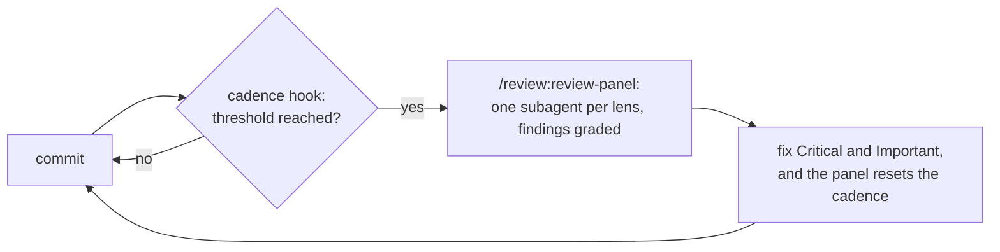
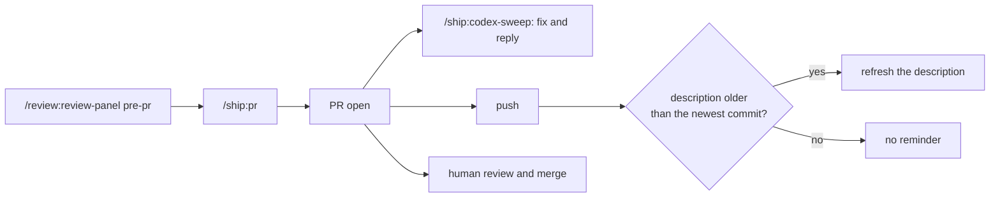
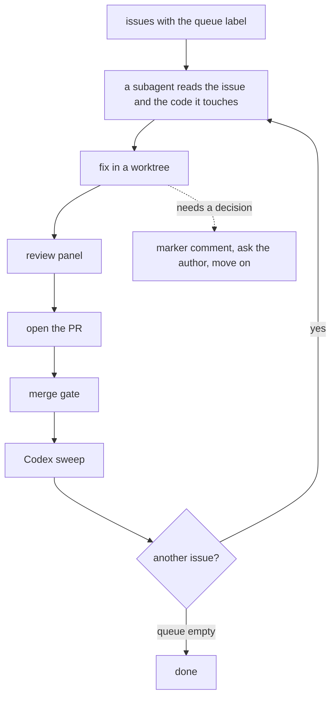

# Usage

The plugins chain into one loop, from a design to a reviewed pull request. [plugins.md](plugins.md)
covers each plugin on its own.

## The loop

1. **Plan.** Draft the design with the plan skills, then cut it into slices.
2. **Build.** Commit as usual. Every five commits or 200 changed lines, a hook nudges `/review:review-panel`. Fix Critical and Important findings.
3. **Open the PR.** `/review:review-panel pre-pr` reviews the whole branch, then `/ship:pr` opens the pull request.
4. **Answer the review.** `/ship:codex-sweep` fixes clear-cut Codex findings and replies. `/ship:pr-feedback` gathers everything else.
5. **Scale out.** Drain a labelled queue through the same steps with `/queue:ship-queue`. Turn
   repeated review comments into rules with `/review:harness-education`.

When the hosted Codex reviewer is installed on the repository, `/ship:pr` also starts a background
wait. It wakes the agent to run `/ship:codex-sweep` once Codex posts its review. After a push, the
drift hook reminds you to refresh the description.

## The review loop

The thresholds are the `review_cadence_commits` and `review_cadence_lines` settings.

## The pull request flow

## A queue drain

A pull request is merge-ready when your `merge_gate` command passes. With no `merge_gate`, your
required GitHub checks decide.
